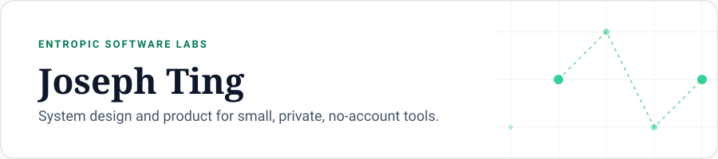

  

  
  
  
  
  
  

I design small tools under [Entropic Software Labs](https://entropicsoftwarelabs.com). Each one fixes one problem, runs on your device, and asks for no account.

> [!NOTE]
> **How these are built.** I decide what each tool should do and how it should work: the problem, the UX and the overall approach. For OffBridge that meant the connection strategy: transfer over the LAN when both devices share a network, and when they don't, go off-grid through SoftAP or through the hotspot one of the devices is already running. Claude (Anthropic's model) designed the cryptography and the protocol details, and writes and tests the code. I review it, test on real devices and ship.

## Projects

<table>
<tr>
<td width="50%" valign="top">

### [OffBridge](https://github.com/josephting1105123/OffBridge)
Files and clipboard between Android and Windows with **no router and no internet**.

QR pairing, then a Bluetooth LE control channel brings up a direct Wi-Fi link, working down a ladder of Wi-Fi Direct, network-specifier, SoftAP and hotspot fallbacks. AES-256-GCM under an ECDH-derived key. Two native Kotlin clients share one wire protocol, kept byte-identical by golden-vector tests.

`Android` `Windows` `BLE` `Wi-Fi Direct` `E2E encryption`

</td>
<td width="50%" valign="top">

### [Spectrum+](https://github.com/josephting1105123/Spectrum-Plus)
An unofficial Android companion for Universiti Malaya's Moodle.

Filters each course down to your own occurrence, so you see only your classes, posts and deadlines, and checks for changes in the background. The session token stays encrypted on the phone; there is no server in between.

`Android` `Moodle` `On-device`

[**Download APK**](https://github.com/josephting1105123/Spectrum-Plus/releases/latest/download/Spectrum.apk)

</td>
</tr>
<tr>
<td width="50%" valign="top">

### [Schedule](https://github.com/josephting1105123/Schedule)
A calendar for the calendars already on your phone.

Today, week and month views plus home-screen widgets. Edits go back to the same calendars. No account of its own, no internet permission.

`Android` `Jetpack Compose` `Widgets`

[**Download APK**](https://github.com/josephting1105123/Schedule/releases/latest/download/Schedule.apk)

</td>
<td width="50%" valign="top">

### [Quick Vote](https://github.com/josephting1105123/Voting-App)
Real-time polls joined with a 6-digit PIN.

The admin admits voters and watches results update live. Node, Express and Socket.IO with all state in memory; rate limits and flood protection are covered by end-to-end tests.

`Node.js` `Socket.IO` `PWA`

</td>
</tr>
<tr>
<td colspan="2" valign="top">

### [Card Games](https://github.com/josephting1105123/Card-Games)
Dou Di Zhu 斗地主, Big Two 锄大地, Blackjack and Texas Hold'em against bots, as an offline PWA with no build step and no dependencies. &nbsp;[**Play it in your browser**](https://josephting1105123.github.io/Card-Games/)

`JavaScript` `PWA` `Game AI`

</td>
</tr>
</table>

More at <a href="https://entropicsoftwarelabs.com/projects/">entropicsoftwarelabs.com/projects</a>

